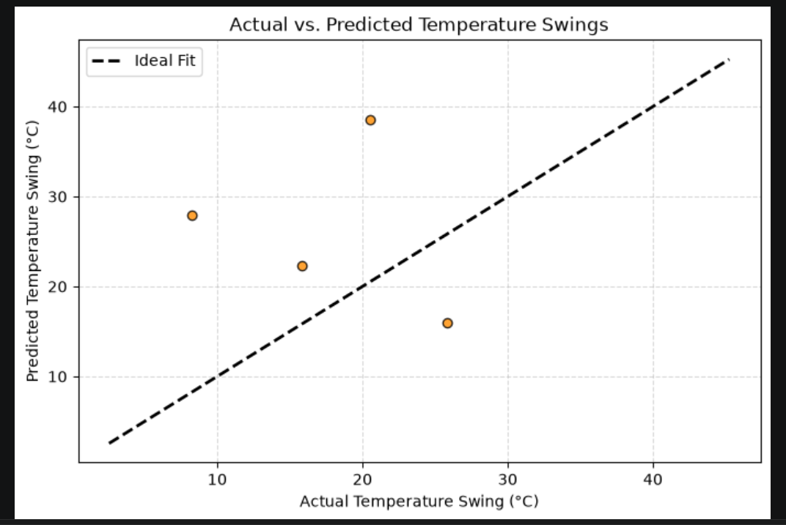

# AI Mini Project — Group 17

## Temperature Swing Prediction with Linear Regression

This project explores historical climate data from **2020–2024** and builds a linear regression model to predict temperature swings.

The notebook cleans and filters the data, explores temperature patterns, trains a model, evaluates its performance, and plots actual versus predicted values.


## Team Members and thier Role

| Team Member | Entry no. | Role |
|---|---|---|
| Nirbhay Singh Gautam | 2026MCB1551 | Documentation Lead |
| Snehit Singh | 2026ESB1495 | Execution Lead |
| Bannoth Veda Kailash Naik | 2026EEB1332 | PPT Lead |
| Anamika Pal | 2026AIB1010 | Video Lead |

## DATASET LINK
https://www.kaggle.com/datasets/atifmasih/climate-change-dataset2020-2024/versions/1?hl=en-IN


## Project Structure

```text
Swings_in_Tempertaure
├── climate_change_dataset.csv    
├── AI_Mini_Project.ipynb            # Code   
├── Requirements.txt                 # All libraries that are used
├── Project-Output.png               # Screeenshot of OUTPUT
└── README.md
```

## Setup
1. Install Python 3.10 or newer.
2. Place AI_Mini_Project.ipynb and climate_change_dataset.csv in the same folder. The notebook expects the dataset to have the exact filename climate_change_dataset.csv.
3. Open a terminal in that folder and create a virtual environment:
   python -m venv .venv
4. Activate the virtual environment:
   Windows (PowerShell):
   .venv\Scripts\Activate.ps1
   macOS or Linux:
   source .venv/bin/activate
5. Install the required packages:
   python -m pip install --upgrade pip
   python -m pip install jupyter pandas numpy matplotlib seaborn scikit-learn kaggle
   python -m pip install -r requirements.txt

##   How to Run the Code
1. In the terminal, navigate to the folder containing the notebook and CSV file.
2. Start Jupyter Notebook:
   jupyter notebook
   You can also start JupyterLab:
   jupyter lab
3. Open AI_Mini_Project.ipynb in the browser.
4. Select the Python kernel for the virtual environment where you installed the packages.
5. Run the notebook cells in order, from the first cell to the last. Alternatively, use Kernel → Restart Kernel and Run All Cells.
6. When execution finishes, review the data summaries, charts, regression coefficients, and evaluation metrics displayed in the notebook.

## Expected Output




## PPT and Video Link

PPT - https://drive.google.com/file/d/17u3AGSZSk4m0zjMohYdQ5TTiAlR5d_ge/view?usp=sharing

Video - https://drive.google.com/file/d/1MJ9Ar_YO9IbKnIKYto9xMfB2rcj03h6G/view?usp=sharing